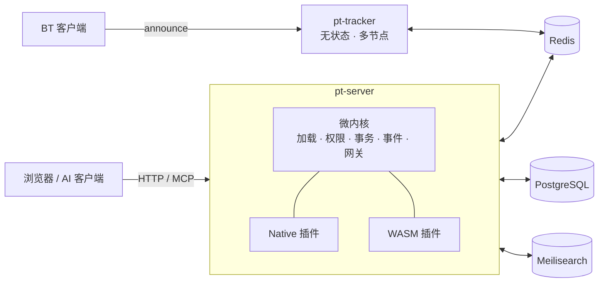

<div align="center">


# PT Studio

**开源的私有 BT 站点（PT 站）系统 · Rust 微内核，一切皆插件**

[](https://github.com/imythu/pt-studio/releases)
[](https://github.com/imythu/pt-studio/pkgs/container/pt-studio)
[](#许可证)
[](#交流)

[快速开始](#快速开始) · [功能清单](docs/features.md) · [文档](docs/README.md) · [插件开发](docs/sdk/README.md) · [更新日志](CHANGELOG.md)

</div>

---

PT Studio 是一套从零设计的 PT 站程序。内核只负责加载、权限、事务、事件与网关，站点的每一项功能——注册、种子、记账、魔力值、等级、H&R、论坛、搜索、AI 助手——都是可替换的插件。

## 特性

- **一切皆插件** — 50 余个官方插件，WASM 沙箱插件与 Native 插件并存；每个插件独立的数据库 schema 与权限，插件 API `pt:plugin@1` 已冻结。
- **为规模而设计** — 无状态多节点 tracker（状态全在 Redis），记账走 Redis Streams 微批落库，所有组件可水平扩展。
- **国内站常用功能齐备** — 魔力值与做种魔力、等级与 VIP、H&R、分享率与新手考核、邀请、认领、商城、勋章、抽奖、论坛、求种、字幕、豆瓣 / PT-Gen 简介、MediaInfo。
- **安全优先** — 2FA（TOTP / WebAuthn）、登录限流、插件包签名、SSRF 防护、严格 CSP，反作弊规则引擎带案件与申诉流程。
- **原生 AI** — 内置 MCP 服务（OAuth、写操作站内确认）、站内助手、AI 上传预审与内容审核。
- **可定制** — 资源类型、术语（“魔力值”叫什么）、主题、站点名都可在插件或后台中修改。

完整的已完成 / 未完成对照见 **[功能清单](docs/features.md)**。

## 架构



tracker 与站点只经 Redis 通信，互不链接代码。设计细节见 [架构总览](docs/design/01-architecture.md)。

## 快速开始

### Docker（推荐体验）

镜像 `ghcr.io/imythu/pt-studio`，包含站点、tracker 与全部插件，数据保存在 `./data/`。

```sh
mkdir pt-studio && cd pt-studio
curl -fsSLO https://raw.githubusercontent.com/imythu/pt-studio/main/deploy/docker/compose.yaml
curl -fsSLO https://raw.githubusercontent.com/imythu/pt-studio/main/deploy/docker/initdb.sh && chmod +x initdb.sh
curl -fsSL  https://raw.githubusercontent.com/imythu/pt-studio/main/deploy/docker/.env.example -o .env   # 修改密码与地址
docker compose up -d
```

打开 http://localhost:31251 注册账号，然后授予管理员：

```sh
docker compose exec server pt-server --config /data/site.toml user grant-role <用户名> admin
```

详见 [Docker 部署](deploy/docker/README.md)。

### 服务器部署

从 [Releases](https://github.com/imythu/pt-studio/releases) 下载 `pt-studio-<版本>-linux-x86_64.tar.gz`，按 [部署指南](deploy/release/DEPLOY.md) 安装（systemd、nginx、备份、升级、故障排查）。

### 从源码运行

需要 Rust（stable）、Node.js ≥ 20、PostgreSQL ≥ 16、Redis ≥ 7.4；Meilisearch 可选。

```sh
deploy/dev/run-site.sh    # 检查依赖、建库、构建、启动：站点 :31251，tracker :31252
```

开发环境与测试见 [开发指南](docs/dev/README.md)。

## 文档

| | |
|---|---|
| [功能清单](docs/features.md) | 已完成与未完成的功能 |
| [文档中心](docs/README.md) | 全部文档的索引与阅读路线 |
| [插件开发指南](docs/sdk/README.md) | 从模板写一个插件：清单、SDK、打包、测试 |
| [设计文档](docs/design/README.md) | 架构、插件系统、tracker 与记账、搜索、AI |
| [平台契约](docs/platform/README.md) | 插件 API、服务 / 事件 / 钩子 / 权限目录、编码规范 |
| [官方插件](docs/plugins/README.md) | 每个插件的状态与设计文档 |
| [llms.txt](llms.txt) | 给 AI 编程工具的文档索引 |

## 项目结构

```
crates/
  kernel/           微内核
  server/           pt-server 可执行文件（Native 插件按 cargo feature 编入）
  plugin-api/       插件契约：WIT、Rust trait、清单类型
  plugin-sdk-rust/  WASM 插件 SDK（pt-plugin-sdk）
  pt-tracker/       HTTP tracker（独立程序，AGPL-3.0-only）
  markup/ release-parser/ type-kit/   共享库：安全渲染、发布名解析、资源类型工具
plugins/
  native/           Native 官方插件
  wasm/             WASM 官方插件
web/                React 前端：外壳、SDK、UI 组件、插件前端、主题
templates/          插件模板（WASM / Native）
deploy/             本机运行脚本、Docker、发布包、数据库初始化、配置示例
docs/               文档
```

## 参与贡献

欢迎提交 Issue 与 Pull Request。开始之前请阅读 [贡献指南](CONTRIBUTING.md)。

## 交流

- QQ 交流群：**1067590352**
- 问题与建议：[GitHub Issues](https://github.com/imythu/pt-studio/issues)

## 许可证

- 内核、插件、SDK 与前端：[MIT](LICENSE-MIT) 或 [Apache-2.0](LICENSE-APACHE)，任选其一。
- `pt-tracker`：[AGPL-3.0-only](crates/pt-tracker/LICENSE)。它是独立程序，只经 Redis 与站点通信，不被其他代码链接，因此不影响站点其余部分的许可证。
